# Evidências de execução — Verzel Store

**Aplicação:** https://verzel-store.qa-test-verzel-store.workers.dev/  
**Data da execução consolidada:** 08/10/2026

Este registro reúne as capturas dos testes manuais, de API e automatizados e as evidências dos defeitos encontrados.

## 1. Execução consolidada — Postman

**24 requisições · 150 verificações · 141 aprovadas · 9 reprovadas · 0 erros de execução.**

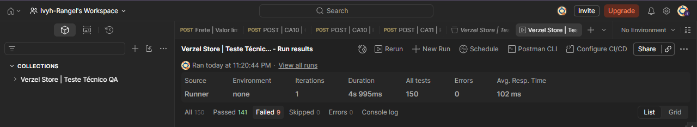

As nove falhas estão agrupadas em quatro requisições: subtotal exato de R$ 200,00 (com e sem cupom) e quantidade superior a cinco unidades nas APIs de cálculo e pedidos.

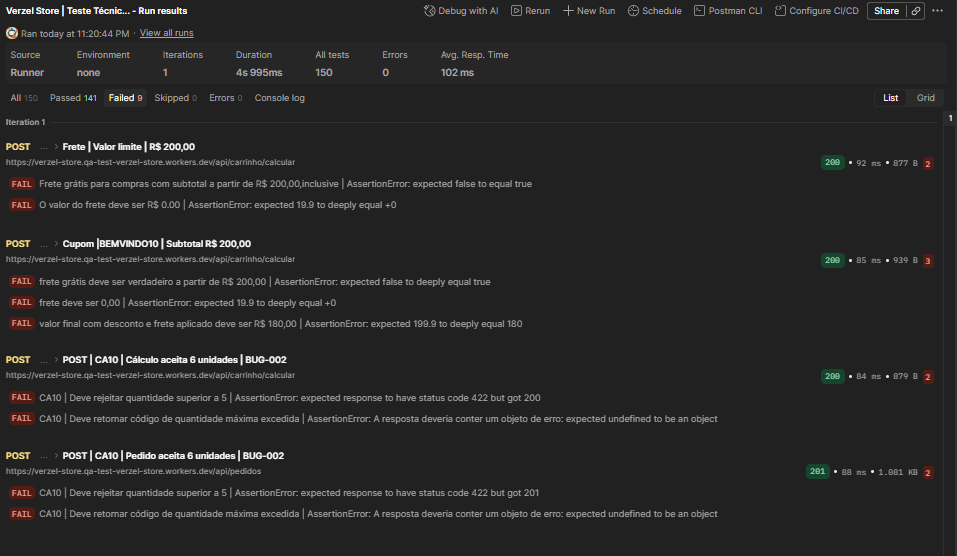

## 2. BUG-001 — Cobrança de frete no subtotal de R$ 200,00

**Regra esperada:** frete gratuito para subtotal igual ou superior a R$ 200,00.  
**Resultado observado:** subtotal R$ 200,00, `freteGratis: false`, frete R$ 19,90 e total R$ 219,90. Duas verificações reprovadas no cenário sem cupom.

[Requisição e resposta](../evidencias/bugs/BUG-001-01-requisicao-e-resposta.png) · [Asserções reprovadas](../evidencias/bugs/BUG-001-02-assercoes-falhando.png) · [Relatório do defeito](bugs/BUG-001-frete-200.md)

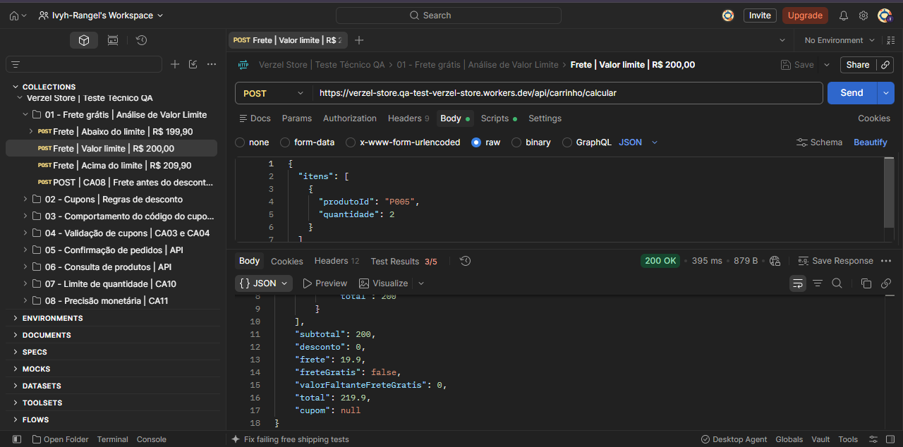

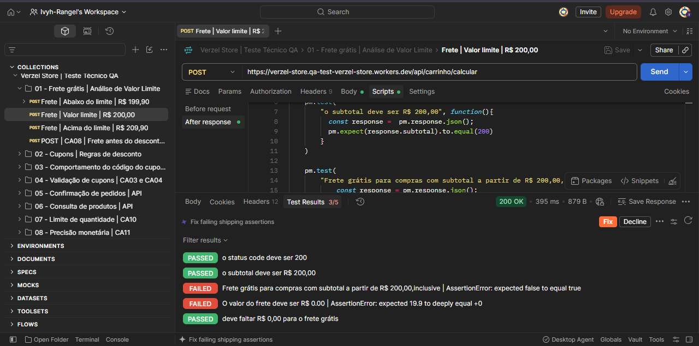

## 3. BUG-002 — API aceita quantidade superior a cinco unidades

**Regra esperada:** quantidade máxima de cinco unidades por produto, com rejeição de requisições inválidas.  
**Resultado observado:** seis unidades de `P007` aceitas por ambos os endpoints.

| Endpoint | HTTP esperado | HTTP obtido | Evidência da resposta | Evidência das asserções |
|---|---:|---:|---|---|
| `POST /api/carrinho/calcular` | 422 | 200 | [Request/response](../evidencias/bugs/BUG-002-01-calculo-requisicao-e-resposta.png) | [Falhas](../evidencias/bugs/BUG-002-02-calculo-assercoes-falhando.png) |
| `POST /api/pedidos` | 422 | 201 | [Request/response](../evidencias/bugs/BUG-002-03-pedido-requisicao-e-resposta.png) | [Falhas](../evidencias/bugs/BUG-002-04-pedido-assercoes-falhando.png) |

[Relatório do defeito](bugs/BUG-002-limite-api.md)

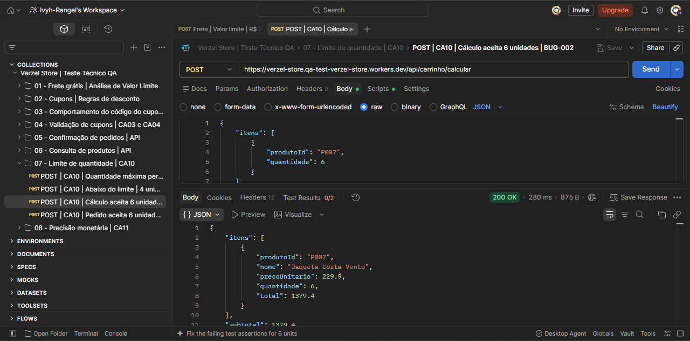

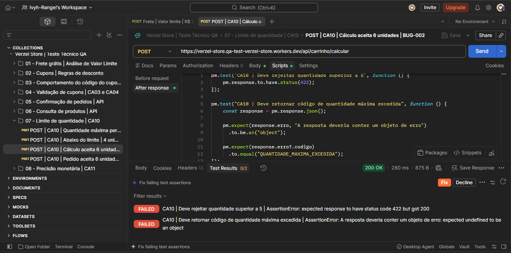

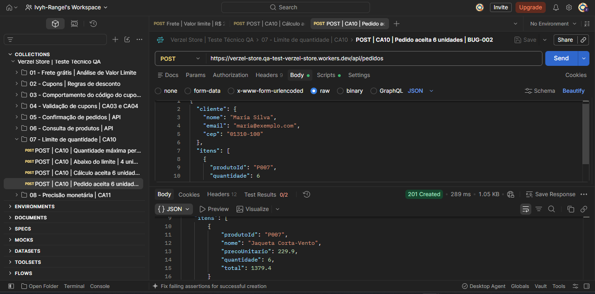

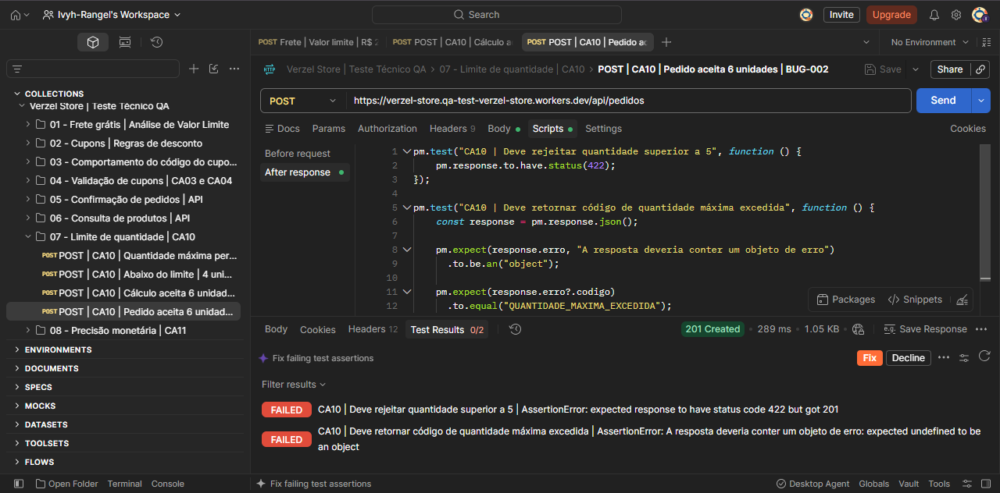

## 4. Interface — Carrinho e cupons

| Cenário | Comportamento observado | Captura |
|---|---|---|
| CA01 — Cupom válido | Desconto R$ 10,00; frete R$ 19,90; total R$ 109,90 | [Cupom aplicado](../evidencias/interface/CA01-CA05-cupom-aplicado.png) |
| Remoção do cupom | Desconto R$ 0,00; total R$ 119,90 | [Após remoção](../evidencias/interface/CA05-cupom-removido.png) |
| CA10 — Limite na interface | Cinco unidades; controle `+` desabilitado; mensagem de limite | [Quantidade máxima](../evidencias/interface/CA10-bloqueio-cinco-unidades.png) |

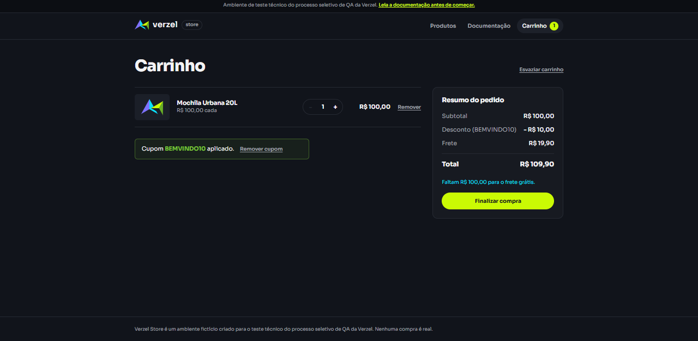

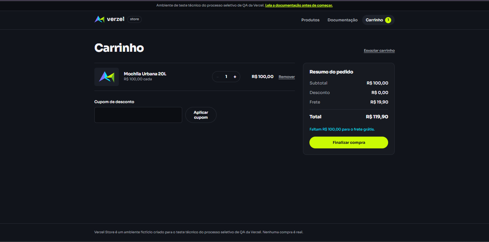

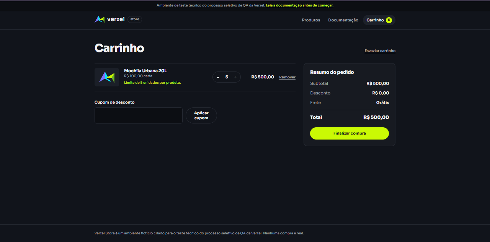

## 5. API — Cenários com resultados conformes

| Critério | Resultado | Captura |
|---|---|---|
| CA08 — Frete calculado antes do desconto | Subtotal R$ 209,90; desconto R$ 20,99; frete grátis; total R$ 188,91; seis verificações aprovadas | [CA08](../evidencias/api/CA08-seis-assercoes-aprovadas.png) |
| CA11 — Valores monetários | Subtotal R$ 139,70; desconto R$ 13,97; frete R$ 19,90; total R$ 145,63; cinco verificações aprovadas | [Response Body](../evidencias/api/CA11-01-resposta-monetaria.png) · [Test Results](../evidencias/api/CA11-02-cinco-assercoes-aprovadas.png) |

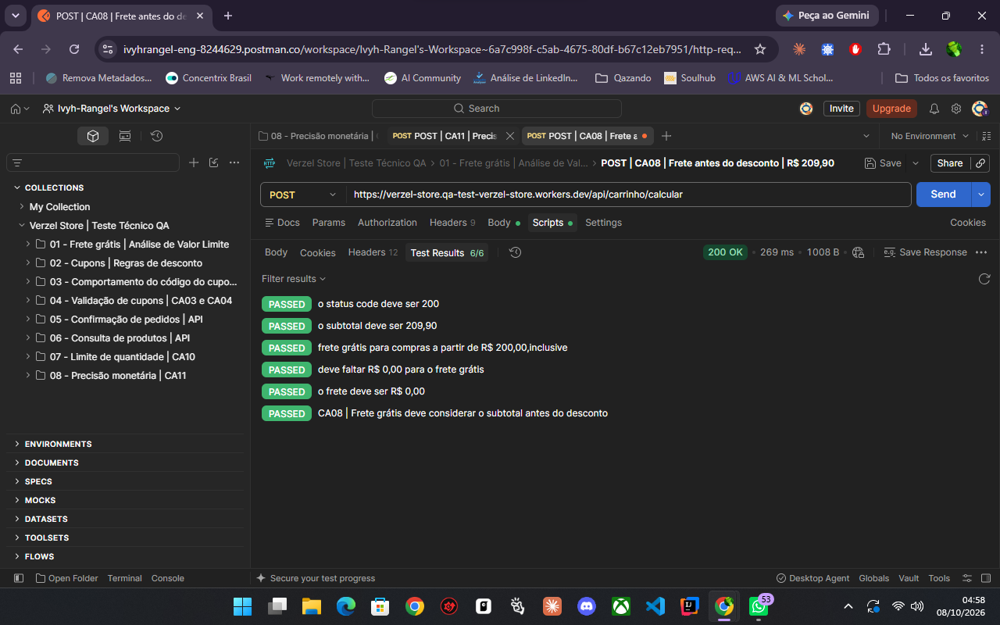

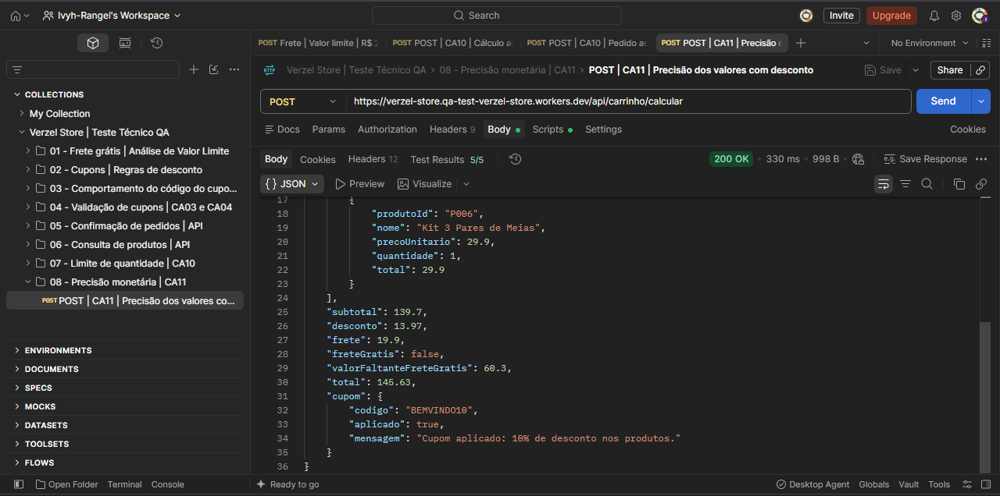

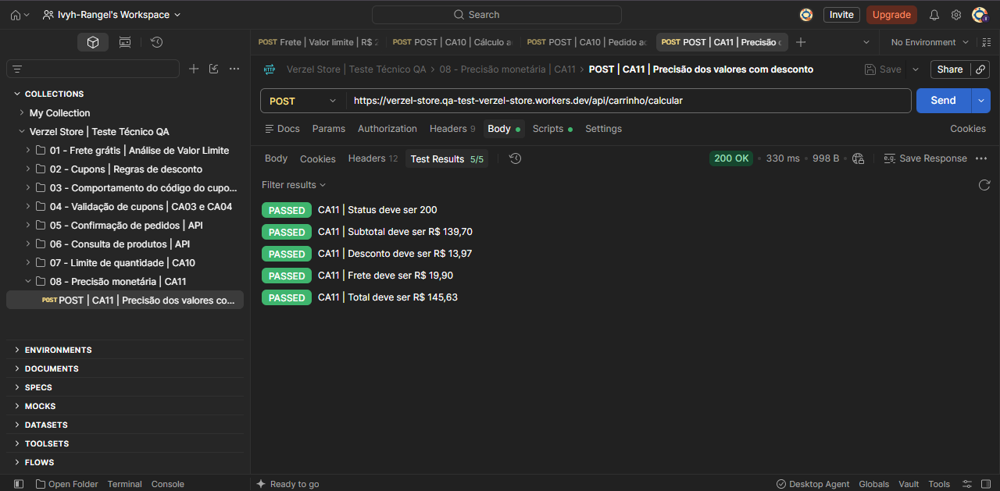

## 6. Automação — Playwright

**Chromium: 5 testes aprovados em 7,4 segundos.**

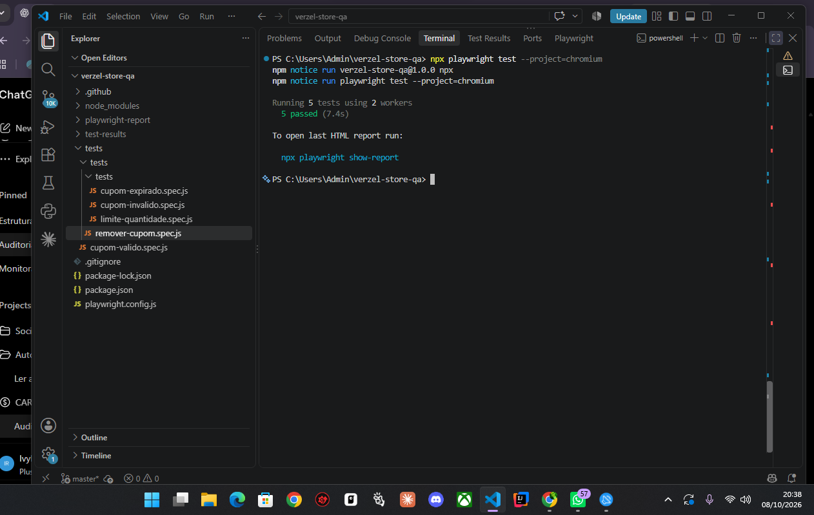

Os scripts de automação estão na pasta [`tests/`](../tests/) e os resultados detalhados de todos os cenários na [matriz de execução](resultados-execucao.md).
